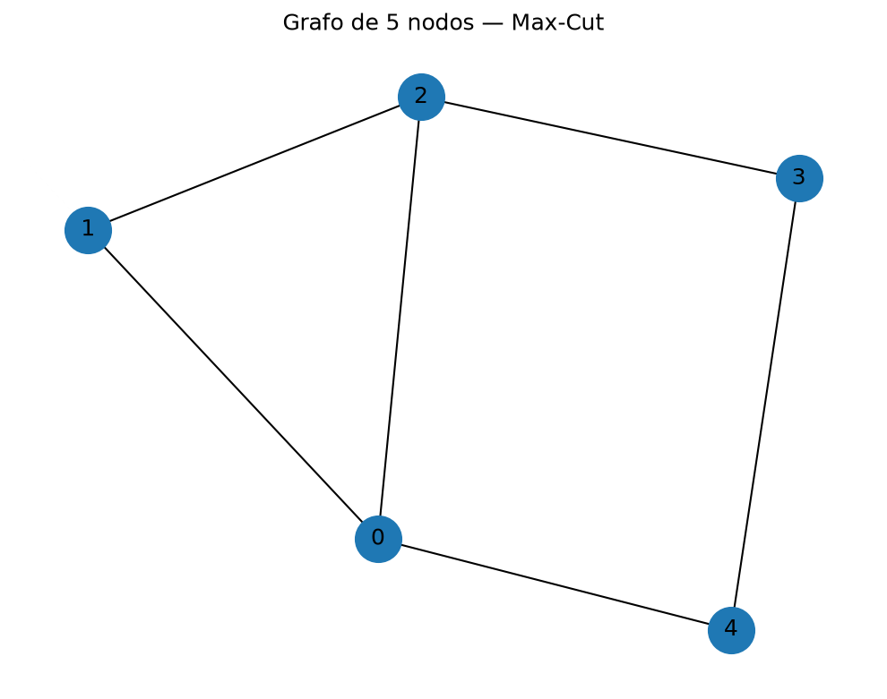
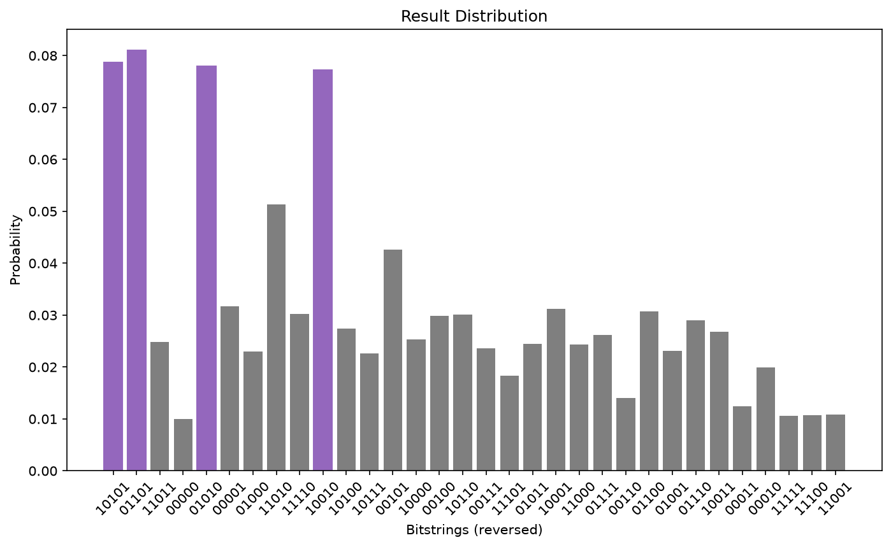
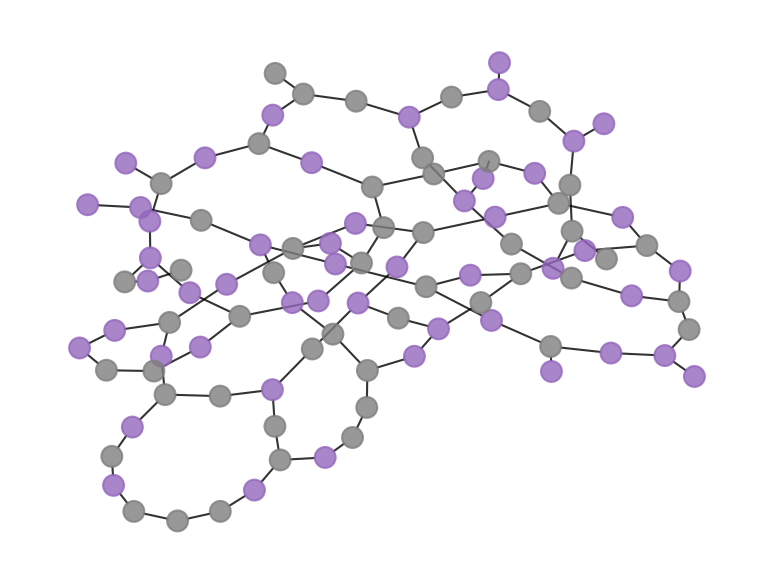
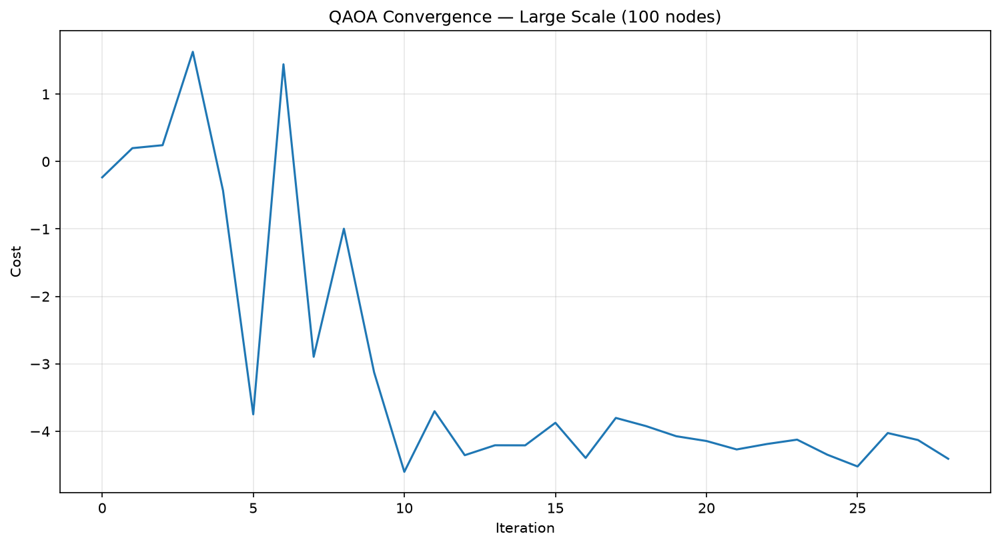
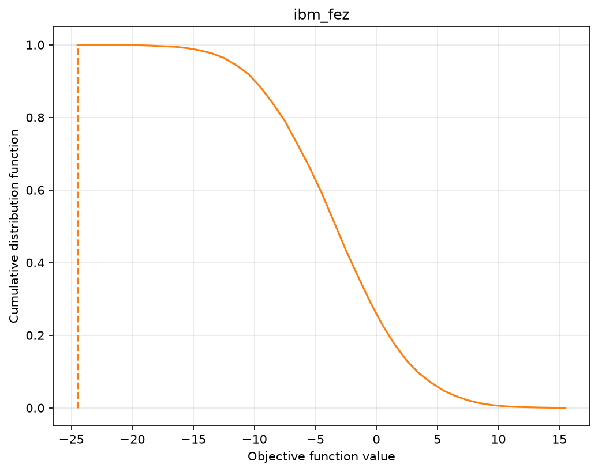

# MaxCut-QAOA

An implementation of the Quantum Approximate Optimization Algorithm (QAOA) applied to the Maximum Cut problem, following the official IBM Quantum tutorial. The workflow runs on real IBM Quantum hardware and scales from a 5-node toy instance all the way to a 100-node utility-scale problem.

---

## The Problem: Maximum Cut

Given an undirected graph, the **Maximum Cut** problem asks for a partition of the nodes into two sets such that the number of edges crossing the partition is maximized. It is an NP-hard combinatorial optimization problem with applications in network analysis, clustering, and statistical physics.

For a graph with nodes $\{0, \ldots, n-1\}$, we assign each node a binary variable $x_i \in \{0, 1\}$ indicating which set it belongs to. The objective is:

$$\max_{x \in \{0,1\}^n} \sum_{(i,j) \in E} x_i + x_j - 2x_i x_j$$

Each edge contributes 1 to the objective if and only if its endpoints are in different sets.

**Small-scale graph (5 nodes, 6 edges):**



---

## From Classical Optimization to Quantum Circuits

The Max-Cut objective is a Quadratic Unconstrained Binary Optimization (QUBO) problem. Through the variable substitution $x_i \rightarrow \frac{1 - Z_i}{2}$, it maps to a **cost Hamiltonian** acting on qubits:

$$H_C = \sum_{(i,j) \in E} \frac{1}{2} Z_i Z_j + \text{const}$$

The ground state of $H_C$ encodes the optimal cut. For the 5-node graph, this yields 6 Pauli terms — one per edge — each with coefficient $0.5$:

```
SparsePauliOp(['IIIZZ', 'IIZIZ', 'ZIIIZ', 'IIZZI', 'IZZII', 'ZZIII'],
              coeffs=[0.5, 0.5, 0.5, 0.5, 0.5, 0.5])
Offset: -3.0
```

The pipeline uses `qiskit-addon-opt-mapper` to automate the three-step conversion: graph → OptimizationProblem → QUBO → Ising Hamiltonian.

---

## The Algorithm: QAOA

The **Quantum Approximate Optimization Algorithm** is a hybrid quantum-classical variational method. It prepares candidate solutions by applying $p$ alternating layers to an initial uniform superposition $H^{\otimes n}|0\rangle$:

1. **Cost operator:** $e^{-i\gamma_k H_C}$ — evolves toward low-energy states of $H_C$
2. **Mixer operator:** $e^{-i\beta_k H_m}$ — explores the solution space

The angles $\{\gamma_k, \beta_k\}_{k=1}^p$ are free parameters optimized by a classical loop. At each iteration, the quantum computer evaluates $\langle H_C \rangle$ via the **Estimator** primitive, and the classical **COBYLA** optimizer updates the parameters until convergence.

**QAOA ansatz circuit (small scale, $p=2$):**


---

## Workflow

The project is organized as a four-step pipeline following IBM Quantum's standard structure:

```
Step 1 — Map:       Graph  →  H_C  →  QAOAAnsatz
Step 2 — Optimize:  Transpile circuit to hardware-native gates
Step 3 — Execute:   Run optimization loop + sample final distribution
Step 4 — Analyze:   Decode bitstring, evaluate cut, visualize results
```

**Convergence of the COBYLA optimizer (small scale):**

The optimizer minimizes $\langle H_C \rangle$ over iterations. A smoothly decreasing curve that plateaus indicates convergence. A noisy, non-monotonic curve signals insufficient shots or hardware noise dominating the signal.

**Final bitstring distribution (small scale):**



The top 4 most probable bitstrings are highlighted. The most likely one is decoded into the two node sets of the partition.

**Best cut found (small scale):**



Grey nodes belong to set 0, purple nodes to set 1. Edges crossing the partition are the cut edges.

---

## Results

### Small Scale (5 nodes, $p=2$)

| Metric | Value |
|---|---|
| Graph | 5 nodes, 6 edges |
| QAOA layers ($p$) | 2 |
| Parameters | $\beta_0, \beta_1, \gamma_0, \gamma_1$ |
| Backend | IBM Quantum (127+ qubit device) |
| COBYLA iterations | ~25-30 |
| QAOA cut value | 4 or 5 |
| Brute-force optimum | 5 |

### Large Scale (100 nodes, $p=1$, utility-scale)

The large-scale graph is built directly from the backend's **coupling map**: each physical coupler between qubits $i$ and $j$ (both $< 100$) becomes an edge. This ensures the graph topology matches the hardware, eliminating routing overhead in transpilation.

| Metric | Value |
|---|---|
| Graph | 100 nodes, 111 edges |
| QAOA layers ($p$) | 1 |
| Parameters | $\beta_0, \gamma_0$ |
| Backend | `ibm_fez` |
| COBYLA iterations | 29 |
| QAOA cut value | **80 / 111 edges** |

**Convergence (large scale):**



**Cumulative distribution function of objective values (large scale):**

The CDF shows the probability of sampling a solution with objective value at least as good as $x$. The dashed vertical line marks the best solution found.



---

## Project Structure

```
MaxCut-QAOA/
├── main.py                                  # Entry point — orchestrates small/large workflow
├── requirements.txt
├── .env                                     # IBM Quantum credentials (not committed)
│
├── src/
│   ├── GraphInitialization/
│   │   ├── small_scale.py                   # 5-node graph construction
│   │   └── large_scale.py                   # 100-node graph from backend coupling map
│   │
│   ├── Quantization/
│   │   ├── model_problem.py                 # Graph -> OptimizationProblem (Maxcut)
│   │   ├── cost_hamiltonian.py              # OptimizationProblem -> QUBO -> H_C
│   │   └── qaoa_ansatz_circuit.py           # H_C -> QAOAAnsatz circuit
│   │
│   ├── QuantumHardwareOptimization/
│   │   └── circuit_transpilation.py         # Circuit -> hardware-native gates
│   │
│   ├── QiskitPrimitivesExecution/
│   │   └── primitives_execution.py          # COBYLA loop (Estimator) + sampling (Sampler)
│   │
│   └── PostProcess/
│       ├── bitstring_decoding.py            # Most likely bitstring + partition + plots
│       ├── brute_force.py                   # Exhaustive classical baseline (small scale)
│       ├── large_scale_analysis.py          # evaluate_sparse_pauli, best_solution
│       └── cdf_visualization.py             # Convergence plot + CDF plot
│
├── utils/
│   └── config/
│       └── env.py                           # Loads credentials from .env
│
└── output/
    └── figures/                             # All generated plots saved here
```

---

## Setup

**1. Clone and create the virtual environment:**

```bash
git clone https://github.com/juandapradam12/MaxCut-QAOA.git
cd MaxCut-QAOA
python3 -m venv .venv
source .venv/bin/activate
pip install -r requirements.txt
```

**2. Configure IBM Quantum credentials:**

Create a `.env` file in the project root:

```
QISKIT_API_KEY=your_token_here
FREE_INSTANCE_CRN=your_crn_here
```

You can find these values at [quantum.cloud.ibm.com](https://quantum.cloud.ibm.com).

**3. Run the small-scale example (5 nodes):**

```bash
python main.py small
```

**4. Run the large-scale example (100 nodes on real hardware):**

```bash
python main.py large
```

---

## Requirements

- Python 3.11+
- Qiskit SDK v2.0 or later (`qiskit[visualization]`)
- Qiskit IBM Runtime v0.22 or later (`qiskit-ibm-runtime`)
- Optimization Mapper addon (`qiskit-addon-opt-mapper`)
- An IBM Quantum account (Open Plan is sufficient for job mode)

> Note: `Session` mode requires a Premium Plan. This implementation uses **job mode** (each optimization iteration is an independent job), which is compatible with the Open Plan.

---

## References

- IBM Quantum tutorial: [Quantum Approximate Optimization Algorithm](https://quantum.cloud.ibm.com/docs/en/tutorials/quantum-approximate-optimization-algorithm)
- Farhi, E., Goldstone, J., & Gutmann, S. (2014). A Quantum Approximate Optimization Algorithm. [arXiv:1411.4028](https://arxiv.org/abs/1411.4028)
- Qiskit addon: [qiskit-addon-opt-mapper](https://qiskit.github.io/qiskit-addon-opt-mapper/)
